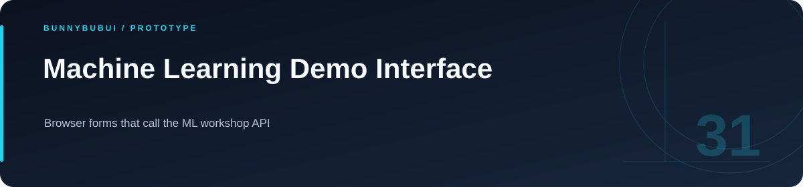

<p align="center">
  
</p>

<h1 align="center">Machine Learning Demo Interface</h1>

<p align="center">Browser forms that call the ML workshop API</p>

<p align="center">
      
</p>

<p align="center"><a href="#overview">ภาพรวม</a> · <a href="#features">ความสามารถ</a> · <a href="#start">เริ่มใช้งาน</a> · <a href="#structure">โครงสร้าง</a> · <a href="#validation">ตรวจสอบงาน</a></p>

<a id="overview"></a>

## ภาพรวม

หน้าเว็บสาธิตการเรียก ML API มีฟอร์มสำหรับงานพยากรณ์และจำแนกข้อมูล พัฒนาด้วย React/TypeScript พร้อม component จากชุด UI และการแสดงสถานะคำขอ

<a id="features"></a>

## ความสามารถที่มีใน source

| ส่วนงาน | รายละเอียด | อ้างอิง |
|---|---|---|
| **Prediction forms** | ฟอร์มราคาตั๋วและงานจำแนกข้อมูล | [ดู source](src/pages/) |
| **API configuration** | กำหนด API base ผ่าน VITE_API_URL | [ดู source](src/config/api.ts) |
| **UI composition** | component และ layout แยกส่วน | [ดู source](src/components/) |

<a id="start"></a>

## เริ่มต้นใช้งาน

**สิ่งที่ต้องมี:** Node.js และ FastAPI จาก workshop ที่พอร์ต 8001

```sh
cp .env.example .env
npm ci
npm run dev
```

กำหนด `VITE_API_URL=http://localhost:8001` และตรวจว่า route/รูปแบบข้อมูลตรงกับ API ที่เปิดใช้งาน

<a id="configuration"></a>

## การตั้งค่า

ตัวอย่างค่าตั้งค่าอยู่ในไฟล์ต่อไปนี้ คัดลอกไปยังชื่อไฟล์ local ที่โปรเจกต์อ่านและกำหนดค่าของเครื่องที่ใช้

| ไฟล์ตัวอย่าง | ตัวแปรสำคัญ |
|---|---|
| [.env.example](.env.example) | `VITE_API_URL` |

<a id="structure"></a>

## โครงสร้างที่ควรเริ่มอ่าน

| ตำแหน่ง | หน้าที่ |
|---|---|
| [src/](src) | source ของแอป |

<a id="validation"></a>

## คำสั่งและผลตรวจ

| โฟลเดอร์ที่รัน | คำสั่งที่มีใน package |
|---|---|
| `.` | `npm run build` |
| `.` | `npm run test` |
| `.` | `npm run lint` |

ดู [ผลตรวจที่บันทึกไว้](docs/VALIDATION.md) สำหรับขอบเขตการทดสอบรอบเตรียมพอร์ต

<a id="scope"></a>

## ขอบเขตของงาน

เริ่มจาก scaffold ของ Lovable; เมื่อนำเสนอผลงานให้ระบุส่วนที่ปรับและเชื่อม API ด้วยตนเอง

<a id="reading"></a>

## อ่านต่อ

- [บันทึกการเตรียม source](docs/CLEANUP.md)


---

<p align="center"><a href="https://github.com/BunnyBubui">BunnyBubui</a> · <a href="https://github.com/BunnyBubui/test">Software Portfolio</a></p>
